# Lab 6: Inheritance OOP — UML Class Diagrams

## Part 1: Practice Exercises (1–9)

### 1. Basic Inheritance "Vehicle & Car"
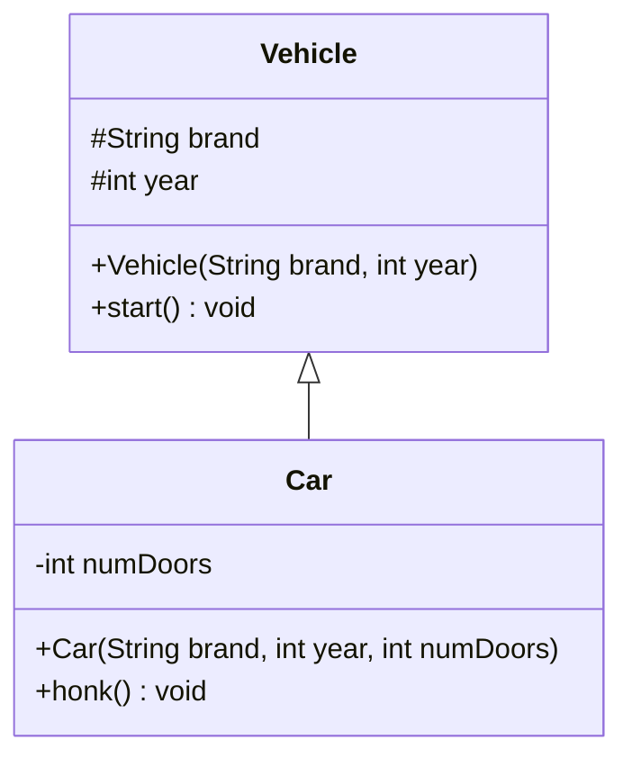

### 2. Method Overriding "Employee & Manager"
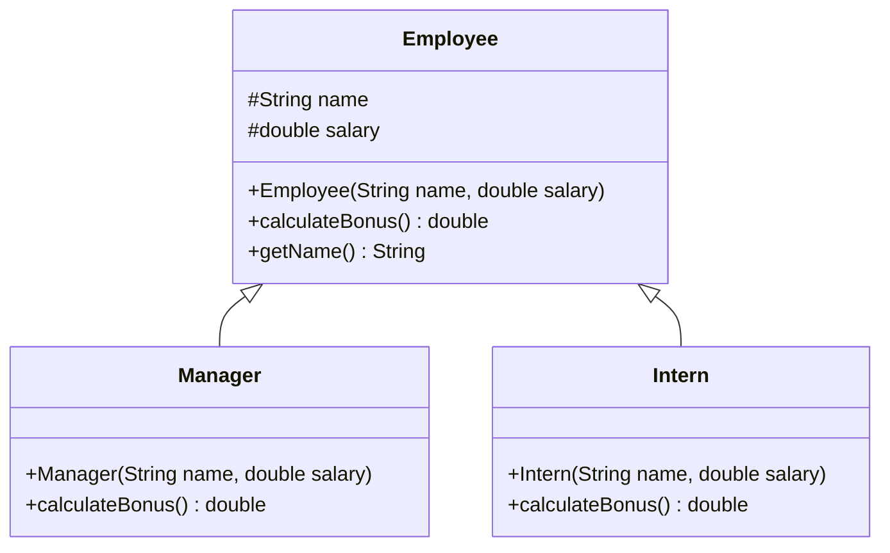

### 3. Multi-Level Inheritance "Person → Student → OnlineStudent"
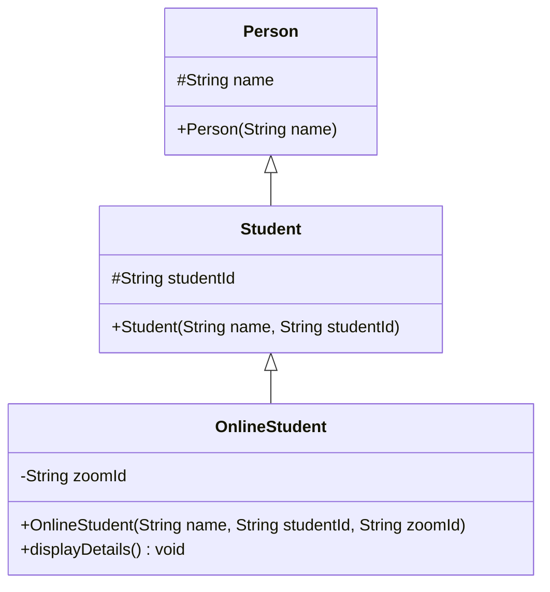

### 4. Calling Parent Constructor "Bank Account Types"
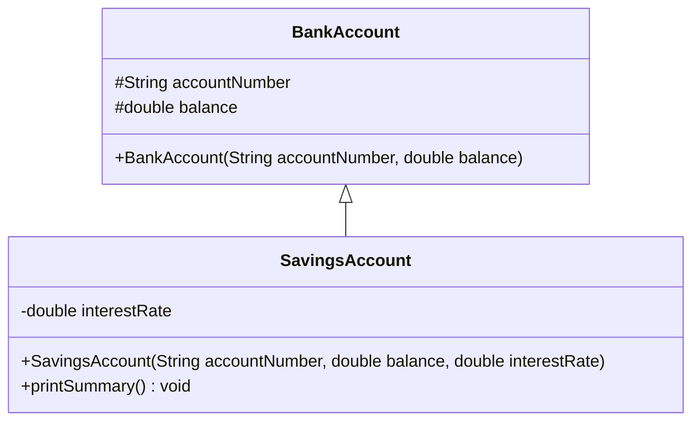

### 5. Using Protected Members "Library Resources"
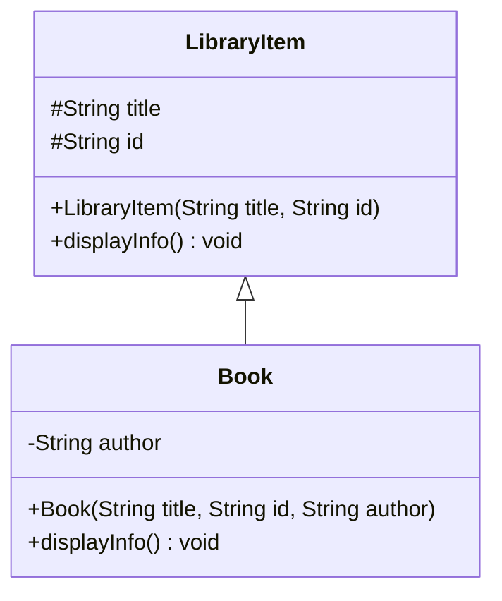

### 6. Hierarchical Inheritance "Shape → Circle, Rectangle, Triangle"
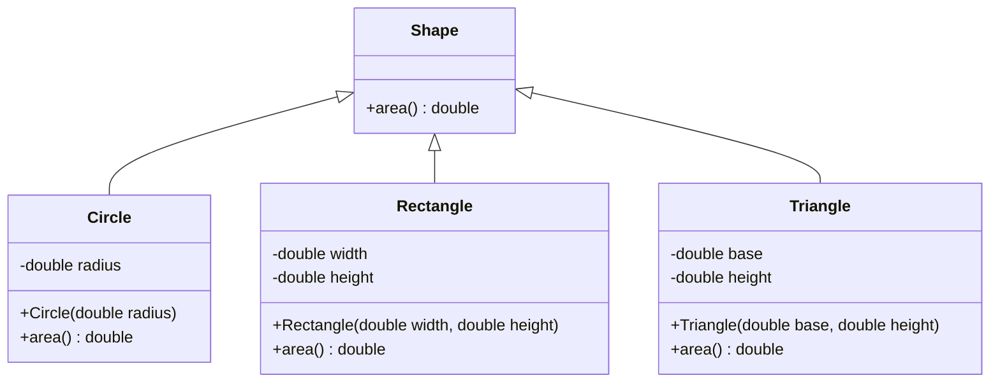

### 7. Abstract Classes "Payment Methods"
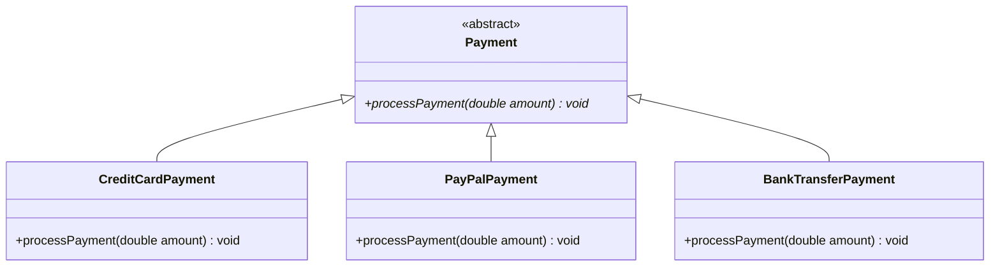

### 8. E-commerce Product Catalog
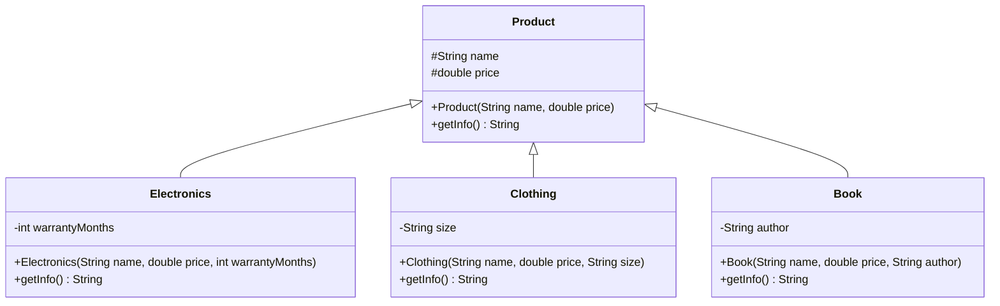

### 9. Transportation System with Pricing Rules
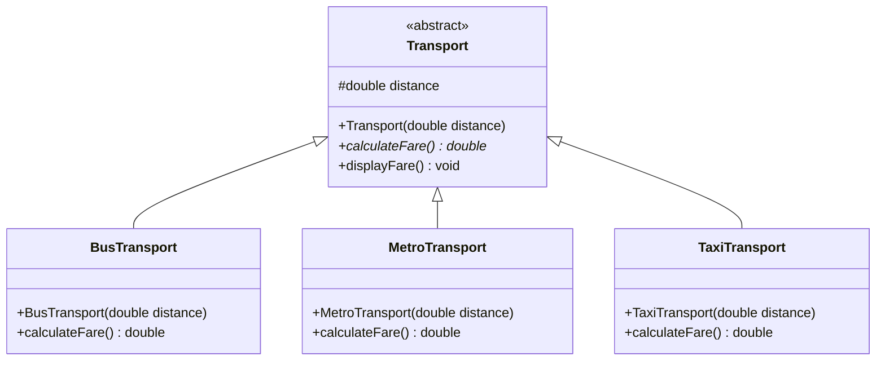

---

## Part 2: Challenges (1–10)

### Challenge 1: Overriding vs Overloading "Insurance Policies"
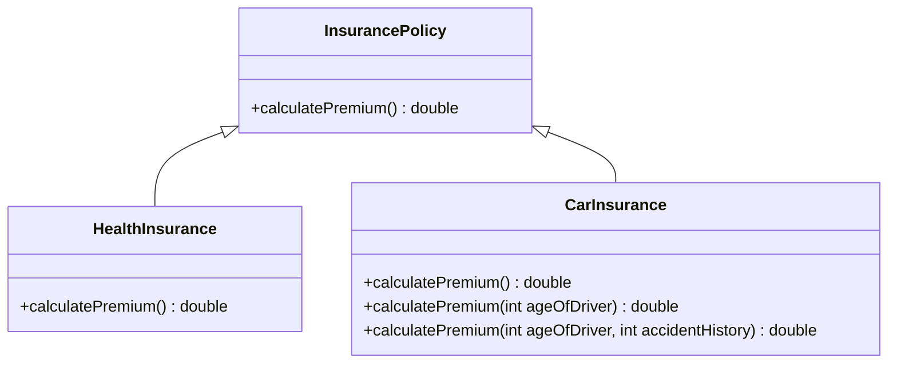

### Challenge 2: Using super() in Overriding "Online Store Discounts"
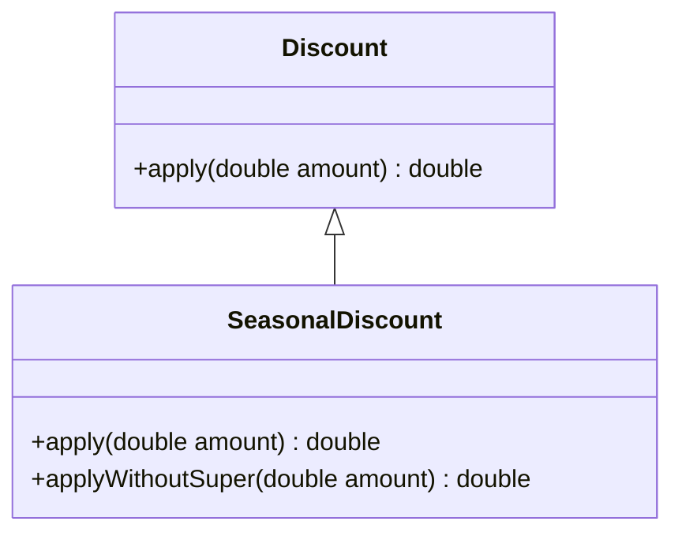

### Challenge 3: Abstract Classes + Interface Mix "Logistics Services"
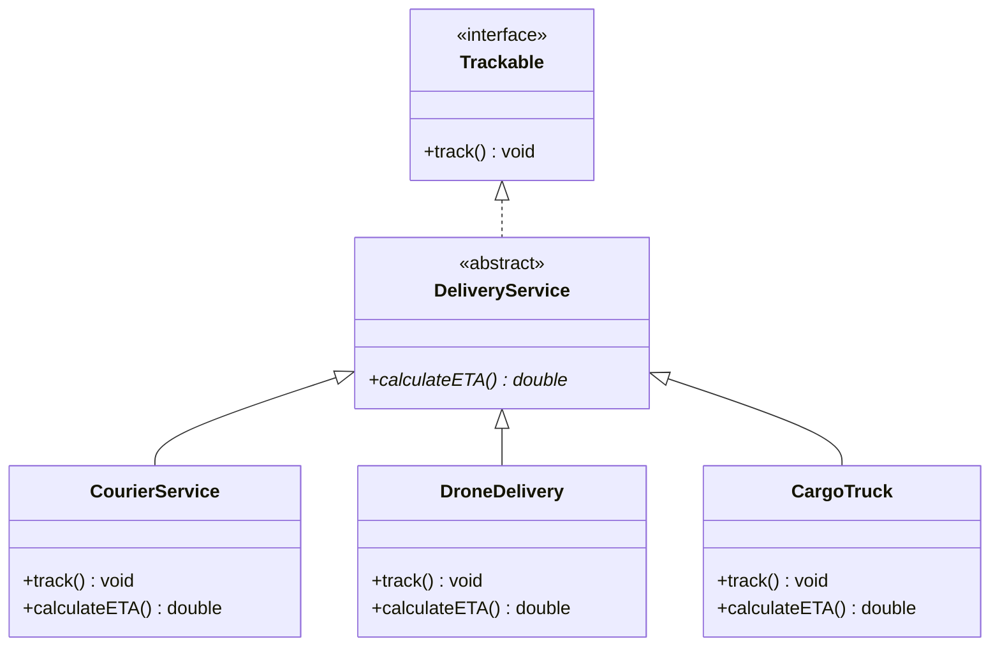

### Challenge 4: Inheriting Exceptions "Bank Transactions"
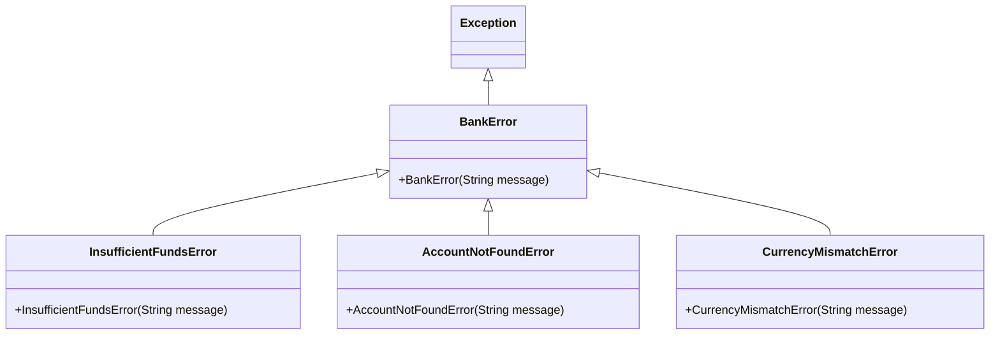

### Challenge 5: Protected vs Private "Hospital Patient Records"
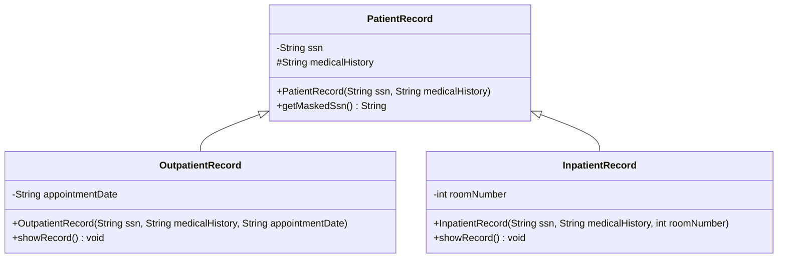

### Challenge 6: Inheritance + Composition "Game Characters"
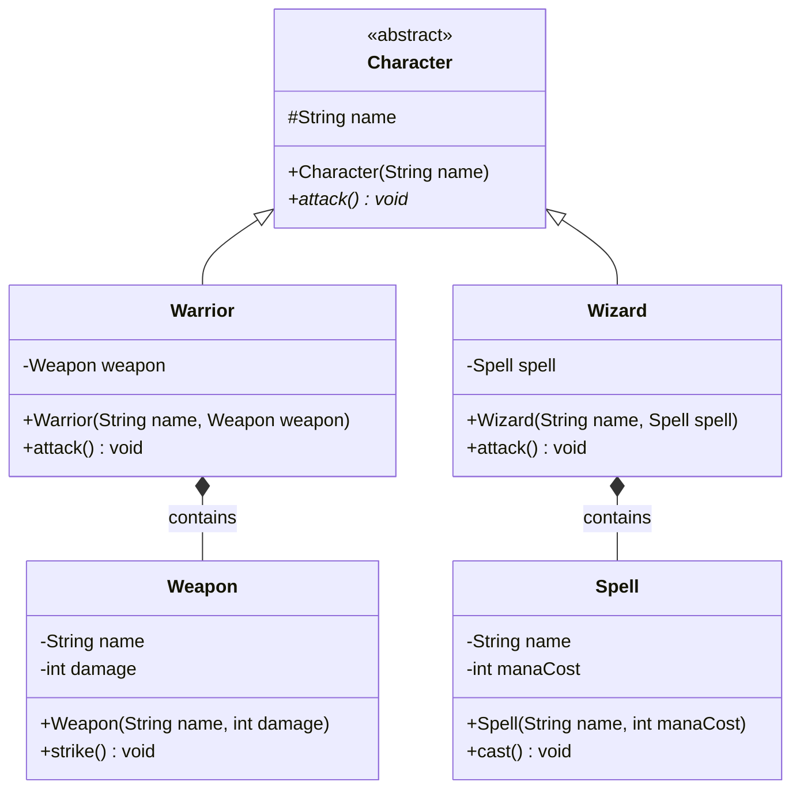

### Challenge 7: Template Method Pattern "Document Generation"
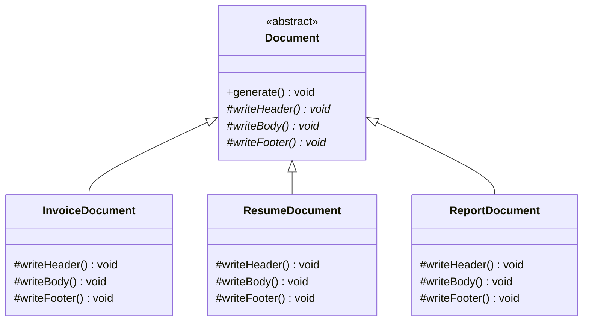

### Challenge 8: Polymorphic Data Storage "Rental System"
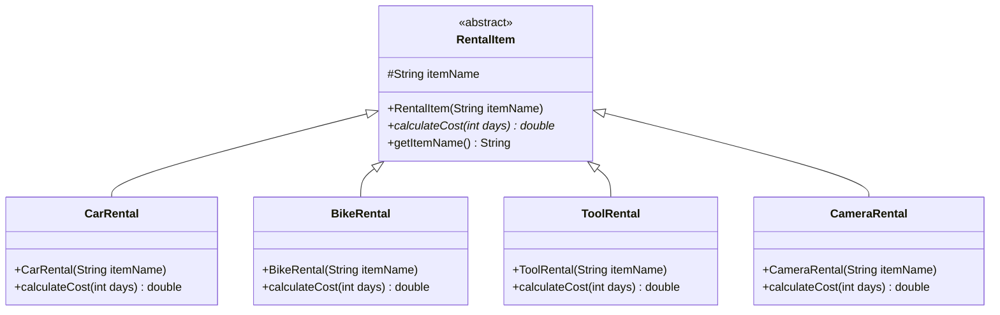

### Challenge 9: Multiple Levels + Overriding + Abstract "Academic Roles"
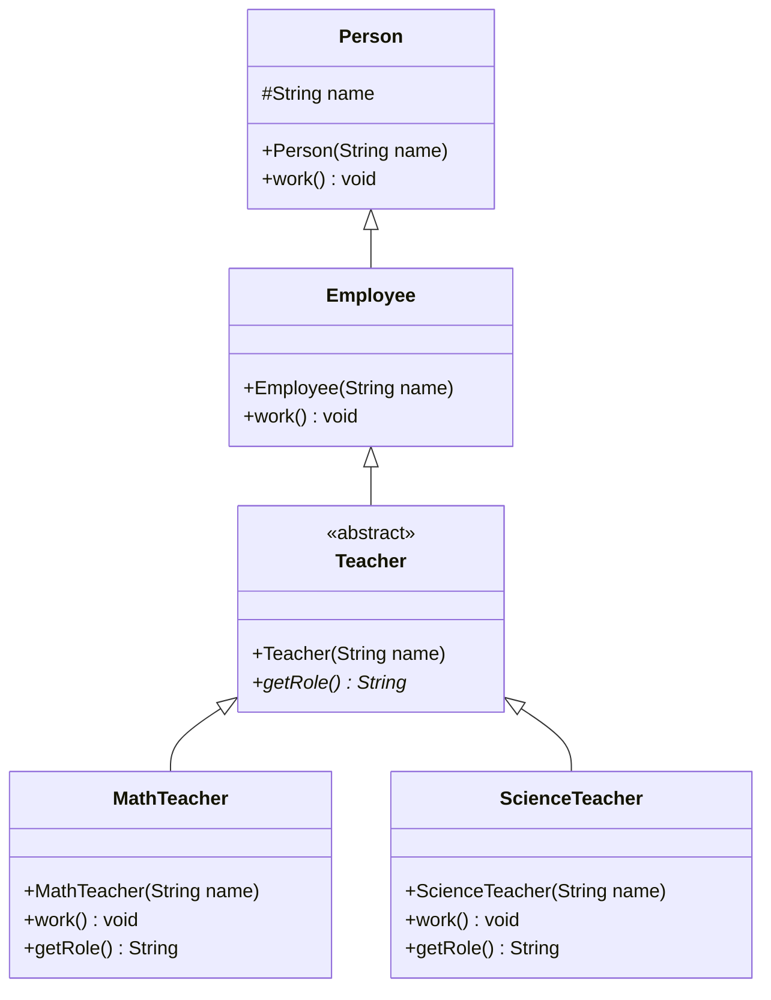

### Challenge 10: Mixin Inheritance "E-Commerce Analytics"
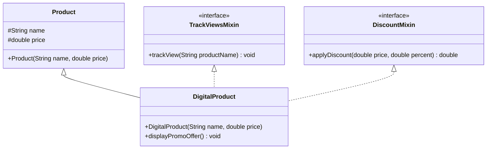
